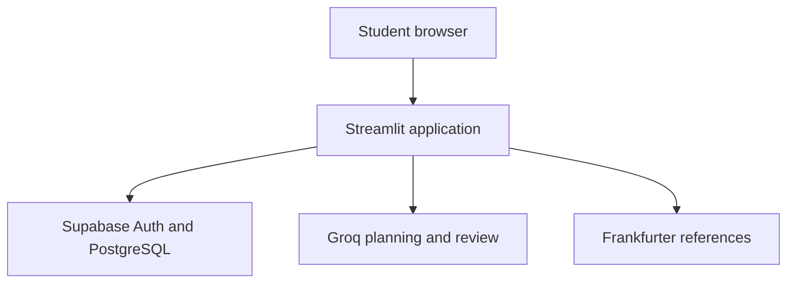
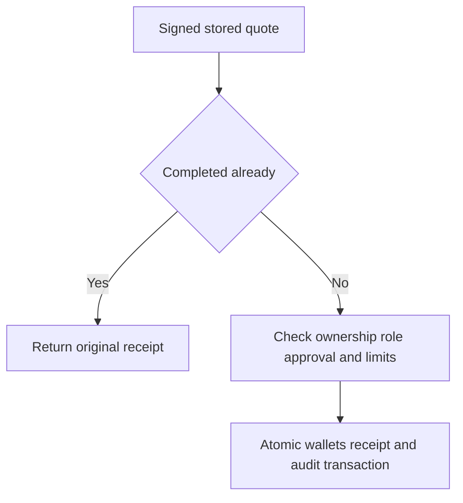

# StudentBridge Technical Documentation

Cross border and student finance assistant

2026 Shenzhen International FinTech Competition International Track

Topic C

Version 4.0.0

Team leader: Md. Sorowar Mahabub Rabby

Master of Science Research Mode, pursuing

Faculty of Engineering and Built Environment

Universiti Kebangsaan Malaysia

Team member: Dr. Hasniza bt Hambali

PhD, Year 3, Faculty of Engineering and Built Environment, UKM

Contact: sorowar.cse1@gmail.com

Documentation updated: 20 October 2026

Live application: https://studentbridge.streamlit.app/

Repository: https://github.com/sorowar-cse/StudentBridge

Reviewed commit: ca161fbfdee8ef9594a577e767d1e7e0836fe242


## 1 Purpose and scope

StudentBridge integrates student budgeting, currency conversion and controlled simulated transfers in one application. A student saves their actual tuition schedule and living costs, receives a monthly cash-flow estimate, and can review a signed transfer quote before explicitly confirming a sandbox operation. The implementation targets an invite-only competition pilot with at most 15 enrolled accounts.

Our contribution is the integration of a constrained AI workflow with deterministic financial tools and database-enforced authority. The system uses existing models and standard security primitives. We call this composition SAGE-FX for this project. We do not claim a newly invented cipher, a validated fraud detector or proven superiority over existing financial products.

The application is implemented in Python and Streamlit. Groq hosts the optional planner and reviewer models. Frankfurter supplies published exchange-rate observations. Supabase Auth and PostgreSQL provide the recommended hosted identity and storage path. The default interface is English, with Bangla, Simplified Chinese and Malay translations. All financial receipts and planning PDFs use English labels.

### 1.1 Financial boundary

Wallet balances, remittance providers and transfer execution are simulated. Campus, Value and Swift are fictional provider fee models. Published FX observations can inform those simulations, but they do not turn them into executable bank quotes. StudentBridge does not process tuition payments, issue university invoices, build credit histories or move real funds.

University records are curated references with source URLs and checked dates. Student-entered tuition and expense figures are explicitly user provided. A user's confirmation establishes their chosen planning inputs, not independent verification of a university fee.

### 1.2 Implemented tasks

| Task | Result | Evidence location |
|---|---|---|
| Personal student planning | Encrypted profile and monthly forecast | profile.py and profile_ui.py |
| Currency conversion | Amount, direction, source and observation date | fx.py and money.py |
| Programme retrieval | Ranked catalogue records and exact source IDs | university.py and agent.py |
| Transfer simulation | Signed quote, approval, atomic ledger and receipt | cloud.py and supabase/schema.sql |
| Permission control | Viewer, planner and executor restrictions | sb_members and execution RPCs |
| Reproducibility | Python tests, SQL checks and synthetic cases | tests, scripts and evaluation directories |

## 2 System architecture



Figure 1. Recommended cloud-backed architecture. The Streamlit server holds application secrets. Each database request carries the student's access token and a publishable project key. The AI path has no ledger execution capability.

The browser interacts with a Streamlit session. Public resources such as the catalogue, translations and trained synthetic risk model may be shared through caches. User tokens and private financial results remain within that user's session. CloudStore is created for the current session and is never a globally cached authenticated client.

The Python service sends structured planning requests to Groq only after consent. It retrieves published FX observations from a fixed API host, validates their currency codes and dates, and computes money using Decimal arithmetic. For hosted storage, Supabase authenticates the user and PostgreSQL restricts data access through RLS and bounded RPCs. Public app tables grant authenticated users SELECT access to their own rows. Direct table writes are unavailable to ordinary app users.

### 2.1 Configuration and deployment

The recommended backend is Supabase both on the developer's PC and in Streamlit Community Cloud. This keeps profiles outside the hosting container's temporary local disk. The same stable master key must be preserved across these environments. Cloud mode stops on configuration or connection failure and never creates a replacement local database.

A separate local preview backend uses SQLite, Argon2 password hashing and a private local key. It supports offline development and regression tests. It does not provide Supabase authentication or hosted persistence. Local SQLite identities do not automatically migrate to Supabase identities.

### 2.2 Main software modules

| Module | Responsibility |
|---|---|
| app.py | Navigation, authentication gates and per-session UI state |
| studentbridge/agent.py | Typed AI plans, reviewer agreement and source grounding |
| studentbridge/personal_assistant.py | Authenticated lookup of the saved next unpaid tuition bill |
| studentbridge/profile.py | Profile validation, billing schedule and forecasts |
| studentbridge/money.py | Currency precision, Decimal arithmetic and minor units |
| studentbridge/fx.py | Fixed-host FX retrieval and freshness validation |
| studentbridge/risk.py | Synthetic Isolation Forest and calibrated anomaly ranks |
| studentbridge/cloud.py | Session-scoped Auth and database RPC adapter |
| supabase/schema.sql | RLS, membership, atomic ledger, limits and audit |

## 3 Data ownership and provenance

The full student profile contains institution, department, programme, study mode, location, planning dates, tuition, monthly expenses, savings and confirmed funding. Each money item includes an amount and currency. The current form groups the five living categories into one selected currency and the three resource fields into another. The internal model supports a currency per money item.

| Information | Provenance | Treatment |
|---|---|---|
| Tuition and living costs in personal profiles | User provided and confirmed | Authenticated encryption before upload |
| Programme references | Curated official URLs and checked dates | Public catalogue, no live-fee claim |
| Published FX observations | Frankfurter response with source and dates | Validate pair, rate and observation age |
| Offline conversion anchors | Invented static dataset | Explicit illustrative label |
| Future expenses | Declared schedule and assumptions | Scenario estimate |
| Sandbox provider costs | Fictional fixed fee, percentage and spread | Simulation disclosure |

### 3.1 Hosted storage

The public application tables are sb_members, sb_documents, sb_wallets, sb_quotes, sb_transfers and sb_events. Every table uses an ownership condition based on auth.uid(). Documents distinguish the student profile from the standalone saved university plan. This avoids overwriting a full personal profile when the user saves a reference scenario.

Profile and plan documents use AES-256-GCM. A fresh 12-byte nonce accompanies each ciphertext. Associated data binds the document to both the user ID and document kind. A ciphertext copied to another user or kind fails authentication. The master key stays in application secrets; distinct HMAC-derived subkeys serve encryption, quote signing and audit functions.

Sandbox balances, quote payloads and operational event details are not application-encrypted. RLS protects their account access. The app operator and database administrator remain trusted. The server's numeric forecast summary may be sent to Groq after consent, while the personal profile review excludes university name, department, email and private note.

## 4 SAGE FX algorithm

The composition has six stages. Existing source retrieval, model review, exact calculations and security controls work together, while financial authority remains outside the language model.

| Stage | Mechanism | Failure behavior |
|---|---|---|
| Source retrieval | TF-IDF word n-grams and cosine similarity over the curated catalogue | Clarify ambiguous programme or classification |
| Structured planning | A planner emits an allowed Pydantic intent and bounded fields | Reject invalid schema or unexpected fields |
| Model review | A reviewer checks the proposed interpretation | Stop if interpretation differs or is rejected |
| Exact tools | Validated amounts, currency direction and source IDs drive Python tools | Reject invented or ambiguous numbers |
| Risk screening | Fixed limits and synthetic calibrated anomaly ranks | Block risky simulation without override |
| Controlled execution | Signed quote, role check, approval and atomic SQL transaction | Reject unauthorized, expired or repeated debit |

### 4.1 Planning and review

The current Groq defaults are openai/gpt-oss-20b and openai/gpt-oss-120b. These are hosted model identifiers, not local downloads. Availability and quota depend on the provider account. The two models belong to the same model family, so agreement is not independent proof of correctness.

For a finance question, the planner sees a masked request and up to four public catalogue records. It emits one of convert, compare, university, budget or clarify. Deterministic validation checks that the amount occurs in the user's question, the direction is explicit, and any university source ID belongs to the retrieved evidence. The reviewer sees the proposed plan and must accept the same normalized interpretation. Only then can the read-only tool run. Model amount formatting is normalized only when it has exactly the same Decimal value as one unambiguous amount in the original question. A model cannot invent an amount or reverse the declared currencies. User-entered financial fields retain the strict plain-decimal parser.

Profile budget priorities use a different review pattern. Both models independently select approved action codes from the numeric scenario and generic study context. The application keeps their intersection, requires fee verification, and removes gap-saving actions when the calculated gap is zero. Python renders the wording and monetary values.

### 4.2 Private tuition lookup

Narrow questions such as "How much is my tuition fee and when should I pay?" use the authenticated saved profile before the general model route. The lookup reports the declared amount, currency, fee period, billing interval and saved next unpaid due date. It makes no Groq call and needs no cloud-model consent. The caller supplies the signed-in user's profile loader; a question cannot select another account.

This answer describes the student's record. It does not verify a university invoice, infer a later semester or mark a bill as paid. Broader budget or affordability questions remain in the existing planning workflow. Suspicious override requests stop before reading a profile.

### 4.3 Planning pseudocode

```text
validate and mask the question
if an instruction override is detected: return BLOCKED
if this is a narrow personal tuition question:
    read only the authenticated profile
    return recorded bill facts with a user-provided source label
retrieve at most four catalogue records
obtain a typed plan or use the deterministic router
validate amounts, direction and evidence identifiers
if LLM review is enabled:
    require reviewer acceptance of the same normalized plan
run only the selected read-only financial tool
return tool facts with provenance and review status
```

There is no eval, arbitrary URL tool, shell tool or model-accessible execute method. The built-in assistant is a deterministic baseline and invokes no LLM. A model's response cannot change an account role or approve a transfer.

## 5 Exact financial calculations

### 5.1 Currency conversion

User money enters as a plain decimal string. The application rejects negative values, unsupported precision, scientific notation and excessively large inputs. Babel supplies currency precision. Wallet records use integer minor units, while exchange rates retain additional Decimal precision. Output rounds using ROUND_HALF_UP to the target currency's precision.

`target = round(amount * reference_rate, target_currency_precision)`

Here r is the validated reference rate and d is the target currency's number of minor-unit digits. RMB aliases to CNY. CNH remains a separate code when the rate provider supports it. A live observation must have the requested pair, a positive finite rate and a date from today back to at most 10 days. Future or older observations fail validation. Composite forecasts and transfer comparisons reject mixed observation dates. Provider outages never silently become illustrative rates.

### 5.2 Personal forecast

The forecast starts from the declared planning date and creates one calendar-month bucket at a time, up to 96 months. Tuition dates recur at the user's actual billing interval, or occur once for an invoice/programme total. Month-end dates derive from the original due date to avoid drift. A tuition amount must already include any applicable invoiced tax; this personal forecast adds no separate tax rate.

Foreign outgoings convert into the selected budget currency and receive the optional FX-stress multiplier. Resources convert without that expense stress. Living costs grow by the declared nominal annual percentage divided by 12 and compounded each month. Tuition fee increases are not inferred. Rounded living cost, tuition and one-time costs form the subtotal; a rounded reserve buffer is added to produce the monthly cost.

`monthly_cost = rounded_subtotal + rounded_reserve`

`closing_balance[m] = closing_balance[m-1] + monthly_income - monthly_cost[m]`

C_m is a rounded monthly cost, I is rounded confirmed monthly income and B_0 combines available savings with confirmed upfront funding. Income arrives before bills within each bucket. Intra-month liquidity, uncertain income and future exchange rates are outside this estimate. The displayed funding gap compares total costs with total resources. A separate timing gap captures the deepest negative monthly closing balance.

### 5.3 Worked synthetic scenario

The following invented example uses MYR throughout, so it needs no external FX rate. It is not an official UKM fee quotation.

| Input or output | Value |
|---|---|
| Planning horizon | 6 months |
| Tuition due in the first month | MYR 5,000 |
| Monthly living costs | MYR 1,800 |
| One-time expenses | MYR 1,000 |
| Reserve buffer | 10 percent |
| Confirmed monthly income | MYR 4,000 |
| Initial savings and other funding | MYR 0 |
| Total cost including reserve | MYR 18,480 |
| Total resources | MYR 24,000 |
| Overall funding gap | MYR 0 |
| Largest monthly cash shortfall | MYR 4,580 |

The example shows why a sufficient total budget can still leave an early tuition shortage. Its first month costs MYR 8,580, against MYR 4,000 of income. Subsequent monthly costs are MYR 1,980. By month six the closing balance reaches MYR 5,520, but the student needs a plan for the earlier MYR 4,580 shortfall.

## 6 Risk screening and execution

### 6.1 Synthetic anomaly screening

RiskEngine fits 160 Isolation Forest trees to 1,200 generated normal transfer examples and calibrates scores on a separate set of 800 generated examples. Features include log amount in USD equivalent, cyclical hour encodings, a new-recipient flag and recent completed-transfer count. A nonconformity score is the negative Isolation Forest score_samples output [4].

`p(x) = (1 + number of calibration scores >= score(x)) / 801; flag if p(x) <= 0.01`

The rank uses the number of calibration scores at least as large as the new score. A value at or below alpha 0.01 triggers the anomaly gate. This is a calibrated anomaly rank under the synthetic distribution, not a probability of fraud. Fixed transfer/frequency limits also apply. The implementation uses split-conformal ideas [5], but no guarantee is claimed for real student transfers or distribution shift.

### 6.2 Signed quote and atomic commit

A quote includes owner ID, scope, currencies, spend/fee/receive minor units, reference data, timestamps and risk assessment. Python signs its canonical JSON with an HMAC-SHA256 subkey. SQL verifies the signature, owner, role and bounded validity window before saving it. A fresh quote lasts 180 seconds.



Figure 2. Authenticated quote execution. The member-row lock serializes an account's debit, credit, receipt and audit changes. Any failure rolls back the transaction. The model is absent from this commit path.

At execution, PostgreSQL obtains the member row lock, verifies the stored quote, and returns a previously completed receipt when the quote ID already exists. A fresh commit requires the executor role, an unexpired quote, the approval checkbox and its final six characters. The database then applies the risk block, USD 2,000 per-transfer limit, USD 5,000 daily UTC limit, maximum five completed transfers in 30 minutes, and sufficient balance. It changes both wallets, inserts the unique receipt and appends the audit event in one transaction.

The final-six-character step is user confirmation rather than MFA. Fictional providers do not represent bank recommendations. Denied SQL operations roll back and do not necessarily produce durable application audit events.

## 7 Security design and operational controls

Supabase Auth verifies credentials and the application retrieves the current user through the Auth API. It obtains the role from owner-controlled membership rows rather than editable profile metadata. Cloud sessions have a 30-minute absolute application lifetime. Refresh tokens remain in the individual server session and never enter URLs or globally cached resources.

| Capability | Viewer | Planner | Executor |
|---|---|---|---|
| Own planning and comparison | Allowed | Allowed | Allowed |
| Save own profile | Allowed | Allowed | Allowed |
| Create executable quote | Denied | Allowed | Allowed |
| Execute simulated transfer | Denied | Denied | Allowed with gates |
| Add simulated wallet funds | Denied | Denied | Allowed |
| Change own database role | Denied | Denied | Denied |

The public RPCs use security-definer privileges with an empty search path, explicit auth.uid ownership checks and bounded parameters. The restricted sb_private schema holds signing/audit subkeys and AI counters. Ordinary authenticated users cannot access those tables or helper functions. An owner-only account utility exists outside the app runtime and prompts privately for its privileged Auth key.

Cloud audit events form a separate HMAC chain per user, anchored by that member's sequence and head. The application verifies the chain before ledger/profile mutations. An external exported head can support checkpoint comparisons, but the database owner remains trusted and the chain does not prove every database row or rejected action was independently witnessed.

AI attempts reserve quota atomically: 20 tasks per user per UTC day, 100 across the pilot per day and three across the pilot per minute. One reviewed task can consume two model calls. Provider limits can be lower. Failures still consume a reservation, protecting the shared allowance from repeated retries. No automatic paid-service fallback exists.

Profile deletion removes saved profile/plan documents. An owner performs full Auth-account deletion when required, with cascading app-record removal. Existing access JWTs may remain valid until provider expiry after logout/reset. App state clears immediately, and a new login clears old financial results and consent.

## 8 Validation and evidence

The finalization record distinguishes local automated tests, owner-run service checks and manual deployment observations. A console transcript supports an owner-reported result; it does not substitute for the original timestamped file. E OWNER_REPORTED_VERIFICATION preserves those supplied excerpts, and the evidence index identifies files still to attach.

| Verification | Observed result | Scope |
|---|---|---|
| Latest local Python suite | 227 passed in 30.25 seconds | Corrected assistant, updated team and UI, calculations, sessions, PDFs and security fixtures |
| Owner PC Python suite | 227 passed in 23.03 seconds | Owner-reported earlier corrected revision; current revision rerun remains to attach |
| Original isolated SQL suite | 23 passed | Historical PGlite RLS and pgcrypto checks with a stubbed Auth claim; SQL source unchanged |
| Owner offline request regression | 366 of 366 completed | Authored synthetic cases, zero LLM calls, owner console supplied |
| Owner hosted security checker | Six checks passed | Actual Supabase REST, grants, encrypted round trip, deletion isolation and audit chains |
| Owner Groq diagnostic | Four checks passed | Planner and reviewer for forecast and assistant, HTTP 200 and schema-valid JSON |
| Owner connection check | Requested checks passed | Configuration, Auth endpoint, MYR/CNY observation dated 2026-10-19 and model catalogue; no inference |
| Deployed manual acceptance | Owner reports success | Login, saved profile, assistant, forecast, converter, PDF, language/UI and team display |

The original release recorded 192 Python tests. The current suite includes the assistant fixes and editable-team tests and now has 227 passing cases. These counts describe different revisions and are not additive.

The authored request corpus contains 956 cases: 354 template-development, 236 development and 366 test/regression cases. Templates are grouped by split, while currency pairs recur. Developers inspected cases while fixing the app. The 366/366 result describes deterministic regression behavior, not blind generalization or real LLM accuracy. The four Groq probes establish access and structured-response compatibility for their synthetic prompts, not a broad accuracy benchmark.

The synthetic risk evaluation flagged 2.2 percent of 500 held-out generated normal examples and all 100 deliberately constructed extreme examples. These results do not validate real-world fraud detection. An enrolled-account cap of 15 is configured and tested in isolated SQL; 15 simultaneous online AI users have not been load-tested.

### 8.1 Remaining execution evidence

The owner confirmed a saved profile was visible on the deployed app. A specifically recorded reboot-and-relogin persistence test is still required. A deployed same-quote replay with matching receipt and unchanged balances, and role-specific viewer/planner execution denials, still need recorded evidence. The six hosted checker passes do not cover every ledger gate or a concurrent network race.

Before submission, attach sanitized source logs, exact run timestamps, the reviewed Git commit and SS01 to SS06. Record one approved sandbox operation and its replay. Keep any unperformed check explicitly pending. Screenshots and the final video must show actual application results.

### 8.2 Interface and usability

The final interface starts in English and provides Bangla, Chinese and Malay translations, including placeholders. Visible ivory input surfaces, resting borders and focus outlines distinguish editable fields. Only an active field has a slow red and gold border animation. The CSS respects reduced-motion preferences. Placeholders are display-only examples and never replace a saved value or calculation default. The owner confirmed the refreshed local and deployed interface worked.

## 9 Limitations and next development

The pilot relies on free-service availability and quota. A paid plan can increase capacity, but changing a plan alone does not validate concurrency, backup recovery or public-registration safety. The public signup switch should remain closed until verified email, recovery, abuse protection and retention processes are implemented.

Losing the master key can make stored documents unreadable. The operator must keep a matching private backup and preserve the key during deployment. A compromised app host or database administrator falls outside the ordinary-user protection boundary. The current application has no permanent browser-login cookie and no claim of instant global JWT revocation.

Forecasts use monthly buckets and confirmed inputs. They do not predict future FX, inflation, employment income, university policy or admission outcomes. University references require programme-specific verification. Profile screenshots and exported PDFs contain financial information and need careful handling.

The next technical milestones are recorded deployed execution/replay evidence, small measured concurrency tests, backup/restore practice, broader consented request evaluation and tested migrations. Real payment execution would require a separately authorized provider integration and operational review.

### 9.1 Release provenance

This document describes the corrected StudentBridge v4 pilot, including assistant, interface and team updates. The original v4 archive SHA256 was 41d550e383a832757f9d57ce59f8d5037cc7c86cc8286ddd862739225a4305f8; it identifies historical evidence only. The owner must insert the current reviewed code commit from git rev-parse HEAD in the front matter. Record a later documentation-only commit separately if needed. Re-run relevant tests after executable changes.

### 9.2 References

[1] Competition announcement and linked International Track brief. https://ird.oou.cmu.ac.th/2026-shenzhen-international-fintech-competition/ and https://drive.scmc.cmu.ac.th/s/2jKErkTJpFmcxYF. Accessed 20 October 2026.

[2] Groq supported models. https://console.groq.com/docs/models. Accessed 20 October 2026.

[3] Frankfurter API documentation. https://frankfurter.dev/. Accessed 20 October 2026.

[4] scikit-learn IsolationForest documentation. https://scikit-learn.org/stable/modules/generated/sklearn.ensemble.IsolationForest.html. The release pins scikit-learn 1.8.0; the stable documentation may describe a newer version.

[5] Angelopoulos and Bates. A Gentle Introduction to Conformal Prediction and Distribution-Free Uncertainty Quantification. arXiv:2107.07511. https://arxiv.org/abs/2107.07511.

[6] Supabase Row Level Security. https://supabase.com/docs/guides/database/postgres/row-level-security.

[7] Cryptography authenticated-encryption documentation. https://cryptography.io/en/latest/hazmat/primitives/aead/. The release pins cryptography 50.0.1; latest documentation may describe a newer version.

[8] StudentBridge v4 implementation and evaluation artifacts. Relevant modules, raw test outputs and dataset provenance are distributed with the source release and identified in C TESTING.


## 10 Application screenshots

**Screenshot slot SS01 — Student profile.** Insert your own running app showing institution and confirmed tuition inputs. Use a synthetic account and conceal its email.

**Screenshot slot SS02 — Personal forecast.** Insert the six-month worked scenario showing MYR 18,480 total cost and MYR 4,580 timing shortfall. Keep the scenario assumptions visible.


## 10 Application screenshots continued

**Screenshot slot SS03 — Published currency reference.** Show a supported conversion with amount, currency direction, provider source and observation date. Do not replace the date with a claim of an executable bank price.

**Screenshot slot SS04 — Signed transfer quote.** Show a small signed sandbox quote, its expiry/risk result and the explicit approval controls. Conceal account identifiers.


## 10 Application screenshots continued

**Screenshot slot SS05 — Receipt and replay evidence.** Show a completed receipt and its replay indication, with unchanged balances or the associated ledger evidence. No real money moves.

**Screenshot slot SS06 — Account isolation or permission denial.** Show B unable to access A data through the provided security checker, or a viewer account blocked from execution. Use only your own test project.


